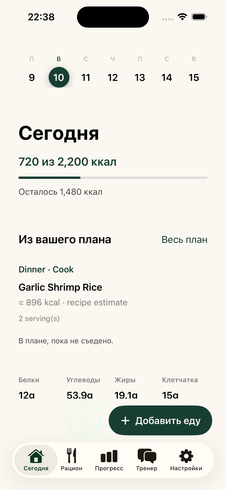

# Kindee

Kindee helps you combine home cooking, nearby cafes and delivery in a meal plan, then record what you actually eat. Its native pilot connects real menu observations to a separate, reviewed AI calorie diary.

- **Android:** Kotlin/Compose pilot built and tested on Solana Seeker. Download the APK from [Releases](https://github.com/Arnon-hs/kindee-app/releases).
- **iPhone:** SwiftUI pilot built and checked in an iPhone 16 simulator. The simulator app is **not** an IPA for a physical iPhone.
- **Real menu pilot:** limited to tested sources near Homa Phuket Town, Phuket. LINE MAN-linked menus and VIVA's merchant menu are available through the private Kindee server; Grab is not connected.
- **Food AI:** the approved Kindee account calls the server. OpenAI credentials stay on the server; results are estimates to review before logging.
- **Nearby places:** Google Maps via Apify finds restaurants and grocery stores for the selected coordinates. These directory listings stay separate from menus, calories and dietary recommendations. See [verification and limits](docs/APIFY_PLACES.md).



[Try the public web demo](https://kindee-eat-well.arnon-hs.chatgpt.site/app/) · [Landing page](https://kindee-eat-well.arnon-hs.chatgpt.site/) · [Verification and limits](docs/IOS_CLOUD_TEST.md)

## Try the native pilot

1. Download `Kindee-Android-Pilot.apk` from the current prerelease and install it on a test Android phone. It uses a Debug signing certificate; this is not a Play Store release.
2. For Apple Silicon Simulator, download `Kindee-iPhone-Simulator.zip`, extract it, boot a simulator and install `calorietracker.app` with `xcrun simctl install booted /path/to/calorietracker.app`.
3. Open Plan and sign in with an approved Kindee test account. Choose an address or location, review preferences, build the mixed week, then confirm Save. A plan does not log food as eaten.
4. Connect Kindee AI from the account sheet. In Today, choose Add food → Photos, select a food photo, analyze it and review the result before saving it to the diary.

The cloud pilot is access-controlled and budget-limited. Installing a binary does not provision server access. Camera, location and health access require the relevant user permissions. Orders are completed in the provider app after checking availability, address and final price.

For a real iPhone, open `native/ios/KindeePhonePilot.xcodeproj` in Xcode, choose your Apple Team for the app and extensions, connect the phone, enable Developer Mode when requested, then Run. HealthKit/iCloud/App Groups require compatible provisioning. A signed device IPA and TestFlight release are not supplied. See [native build instructions](native/README.md).

## Source layout

| Path | Purpose |
| --- | --- |
| `native/android`, `native/ios` | Current Fud AI-based Kindee pilot, with original notices retained |
| `native/shared`, `native/local-models/legal` | Shared manifests, 96 Debug sample frames and offline notices; no model weights |
| `src`, root `android`, root `ios` | Earlier Vue PWA and Capacitor/Watch projects, retained separately |
| `docs/IOS_CLOUD_TEST.md` | Actual simulator/server checks and their limits |
| `anti-slop/` | Measured Vue audit and a staged quality rollout plan |

The Laravel API and menu collectors live in the private `kindee-platform` repository. This public repository contains clients, not the backend or its credentials.

## Build the retained web client

Requires Node.js 22.12+ and npm. The tests include a check of built PWA files, so build first:

```sh
npm ci
KINDEE_PUBLIC_DEMO=true npm run build
KINDEE_PUBLIC_DEMO=true npm test
npm run test:state
npm run dev
```

The public demo uses an illustrative recipe catalog and keeps personal entries only in tab memory until reload. The authenticated client needs a separately deployed API. Earlier native/Watch instructions remain in [docs](docs/HEALTH_AND_ONBOARDING.md); they do not certify the new pilot or physical watch synchronization.

## Design and agent checks

Read [DESIGN.md](DESIGN.md), [AGENTS.md](AGENTS.md), [quality checks](docs/QUALITY_CHECKS.md), [Git/Codex hooks](docs/QUALITY_HOOKS.md) and [skill usage](docs/SKILLS.md). The anti-slop audit applies to Vue/TypeScript; Swift/Kotlin retain their platform checks. Git pre-commit checks staged source, CI checks changed lint/dead code/clones and API drift, and the prepared Codex Stop hook requires its own trust review. No new design framework replaces the existing native controls.

## License and support

Original Kindee client source retains its [MIT license](LICENSE). The native pilot derives from [Fud AI](https://github.com/apoorvdarshan/fud-ai) by Apoorv Darshan under its preserved [MIT license](native/LICENSE). Dependencies, photographs, exercise assets and optional models keep their own terms; see [NOTICE.md](NOTICE.md).

Use [GitHub issues](https://github.com/Arnon-hs/kindee-app/issues) for reproducible non-sensitive bug reports. Do not include provider keys, session tokens or health records. This is a test release; measured food nutrition, universal delivery coverage, physical Apple Health/watch synchronization and production readiness are not claimed.
