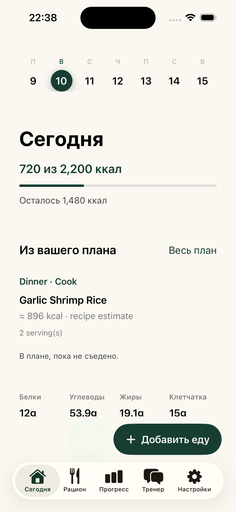
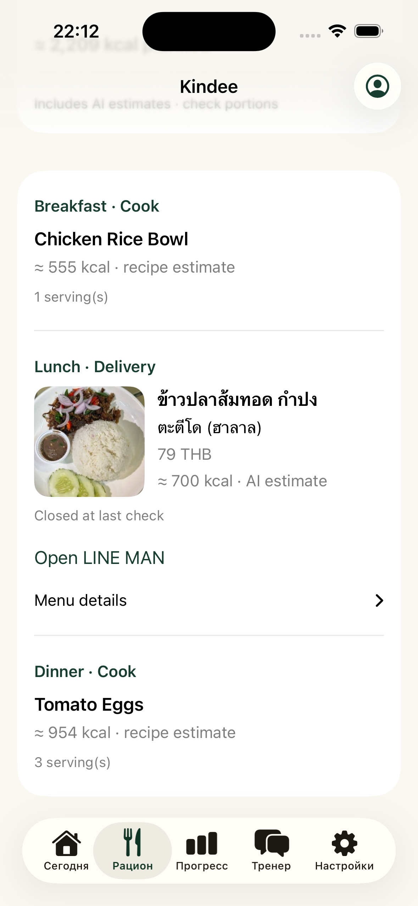
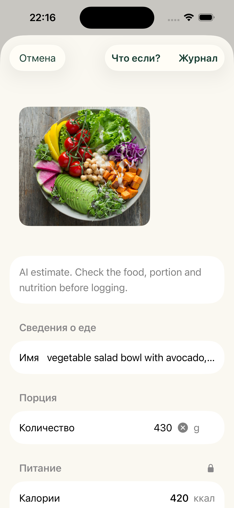
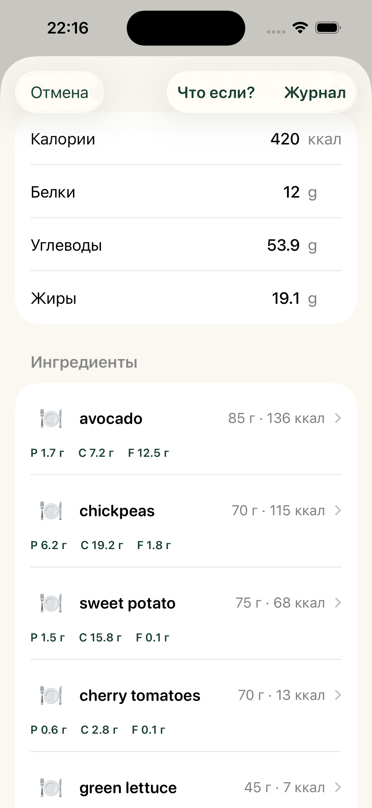

# iOS cloud pilot verification

Verified on 2026-11-10, Asia/Bangkok, with an Apple Silicon iPhone 16 Simulator running iOS 26.5 and Xcode 26.6. These are observed runtime results, not just a source review or HTTP health check.

## Connected scenario

The app signed in through its normal account form to the existing Kindee HTTPS API. A separate synthetic account and profile were used: maintenance, 2,200 kcal/day, mixed cooking/cafe/delivery, no exclusions, Homa Phuket Town. No real user's profile or diary was changed. The session and Kindee AI configuration survived app relaunch and installation of the final build.

1. Nearby catalog returned **50 real menu observations: 10 cafe and 40 delivery**. Visible examples included VIVA Tropical Bowl at 210 THB, Caesar Salad con Pollo at 310 THB, LINE MAN-linked What? dishes from 60 THB, and a Tati Do delivery dish at 79 THB. Actual photos, source labels and observation timestamps appeared. Grab was not connected.
2. Generated and explicitly saved **21 planned meals: 14 cooking, 4 cafe and 3 delivery**. Daily totals included 2,210 and 2,209 kcal against the 2,200 target. Estimated restaurant nutrition was allowed in this synthetic profile and labeled as estimated. Creating a plan left the server diary empty.
3. Connected Kindee AI, selected a real non-personal food photo from Photos, and requested analysis through the server. The response estimated **420 kcal for 430 g**, protein 12 g, carbohydrate 53.9 g, fat 19.1 g and fiber 15 g. The screen displayed the original photo, ingredients and an estimate warning. This proves the request/result flow, not nutritional accuracy.
4. Explicitly saved that estimate to the local diary. The existing 300 kcal test entry plus 420 became **720 kcal**. After explicitly applying Kindee nutrition targets, Today displayed **720 / 2,200 kcal**, 1,480 remaining and the nearest saved dinner. The nearest meal was marked planned, not eaten.
5. Installed and launched the final resource-complete build. Today still displayed the persisted diary and saved meal. The photo AI call was not repeated unnecessarily.

Two actual account-level AI calls were used: menu-plan estimates and photo analysis. The account allowance moved from 10 to 8 remaining. The server used `gpt-5.4-mini`; no OpenAI key was embedded in either mobile app.

## Fixes demonstrated by this check

- Simulator signing stays enabled with an ad-hoc identity. The client reports connected only after Keychain save succeeds and the session reads back correctly. Account errors remain visible inside the native Form.
- Wire dates use the Gregorian calendar even when the user's local calendar is Buddhist. A regression fixture failed before this fix and passed after it; Today then displayed the saved meal in the Thai locale.
- Two Android test expectations were updated to match the existing model registry and the deliberately visible Plan tab. No Android production behavior was changed by those test edits.

## Verification levels

| Check | Result |
| --- | --- |
| iPhone-only Simulator build | Passed, arm64 Debug, SDK 26.5 |
| Simulator secure session, menus, save mixed plan, photo AI, diary, relaunch | Passed with synthetic profile |
| Pure Swift meal/date/AI-boundary contracts | Passed, including Buddhist-calendar regression |
| Android native unit tests | 1,000 passed, 0 failures/errors/skips |
| Fresh native Android Debug APK | Built successfully; not reinstalled on Seeker during this check |
| Retained Vue PWA build, tests, session check | Passed locally; build must precede tests |
| New native clients in GitHub CI | Not covered by the retained web/Capacitor workflow |
| Physical iPhone, camera, Apple Watch/Health, iPad, TestFlight | Not verified |

The isolated Debug Simulator launch bypassed onboarding and disabled Health/iCloud/notifications for the fixture. Full normal onboarding and real permission consent were not part of this acceptance. The existing server's own limits and allowlists still apply. AI targets require explicit adoption, and planned food remains separate from consumed food.

## Server boundary and unchanged projects

The existing server release remained `258f37a32c35505ac11a237f3f6aa7fb272d6cebf9c049d94ac9ca9283364c2d`. Only Kindee's two pilot account allowlists were extended for the synthetic account; only its API container was recreated with the same image, secrets and budgets. All **44 other containers** retained the same identity and start time. No new container was introduced. Database and gateway were not restarted. The original Kindee compose was retained in a protected rollback location.

## Data limits and follow-up

Menu records are observations with sources and timestamps. They do not prove that a restaurant is open now, accepts this exact address, still charges that price or has delivery stock. One observed item explicitly showed closed at last check. Provider handoff and final price/address confirmation remain the provider app's responsibility. This check did not place an order, verify Grab ingestion, or prove a new collector refresh schedule. Runtime photos are links, not a freely redistributable restaurant-photo dataset.

The diary result here was local to the test Simulator; it was not silently copied into the server diary. Health/watch data and actual measured nutrition were not verified.

The global anti-slop skills were applied to a measured Vue audit, documented in `anti-slop/`. No new quality gates were enabled by this release. Dependency audit findings remain in the retained web toolchain and need a separate, bounded triage; this is not a clean security-audit claim. The imported native snapshot retains upstream whitespace conventions, including CRLF in the Windows Gradle wrapper; a full import diff therefore reports inherited whitespace warnings. New release docs/scripts and the Swift contract fixture pass scoped diff checks.

The public release includes source and licenses, not server records, account credentials, cached photos or optional model weights.
